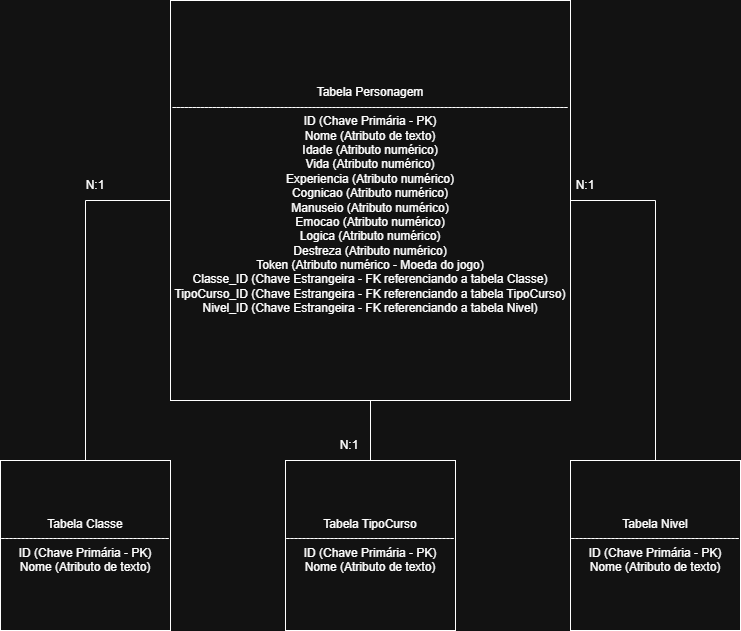

# SENAI Agile RPG — MySQL

Banco de um RPG educacional com personagens, classes profissionais, cursos, níveis e mercado de itens.

Projeto acadêmico desenvolvido no curso Técnico em Desenvolvimento de Sistemas — SENAI.

**Autor:** Matheus Macêdo Felicio  
**Tecnologia:** SQL / MySQL  
**Banco:** `SENAIAgile`

## O que demonstra

5 tabelas, atributos de personagens, consultas, agregações e 9 views.

## Modelagem



## Executar

Ambiente-alvo: MySQL 8.0.16 ou superior, com cliente MySQL ou MySQL Workbench.
Use uma instância de estudos e um banco ainda não existente com esse nome. A instalação não apaga bancos existentes e não deve ser repetida na mesma base.

No terminal, entre na pasta deste projeto e conecte-se:

```bash
mysql --default-character-set=utf8mb4 -u root -p
```

No cliente MySQL, execute na ordem:

```sql
SOURCE sql/01_schema.sql;
SOURCE sql/02_dados.sql;
SOURCE sql/03_consultas.sql;
SOURCE sql/04_views.sql;
```

No Workbench, abra os mesmos arquivos nessa ordem e execute cada um. O arquivo de dados deve ser executado uma única vez. Algumas atualizações didáticas podem exigir a revisão da opção Safe Updates do cliente.

`sql/05_manipulacao_exemplos.sql` é opcional e altera dados; leia os comentários antes de executar.

## Organização

- `sql/`: estrutura, carga e consultas/rotinas separadas por ordem de execução.
- `docs/diagramas/`: modelo relacional enviado na atividade.
- `docs/REVISAO.md`: alterações realizadas e limitações conhecidas.

## Verificação

Revisão estática dos scripts e conferência da organização dos arquivos. **Execução no MySQL ainda não validada neste ambiente.** Consulte `docs/REVISAO.md` antes de apresentar o projeto como aplicação pronta para produção.

## Contexto acadêmico

O repositório documenta um estudo de banco de dados. Materiais de aula e dados de exemplo não são apresentados como criação integral do autor. Não foi atribuída licença de redistribuição aos materiais de terceiros.
